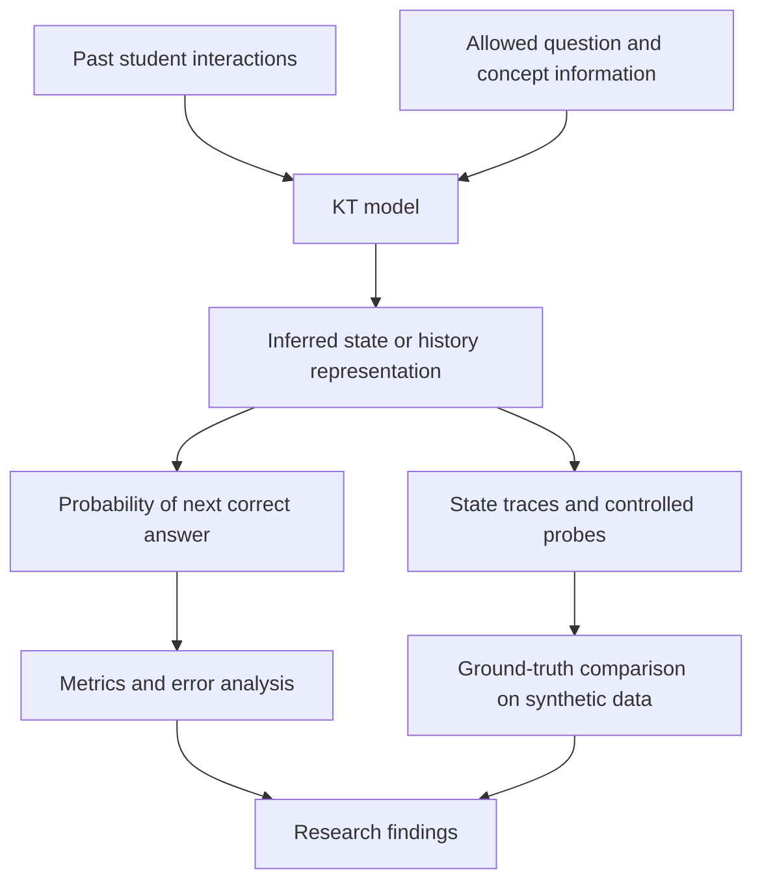
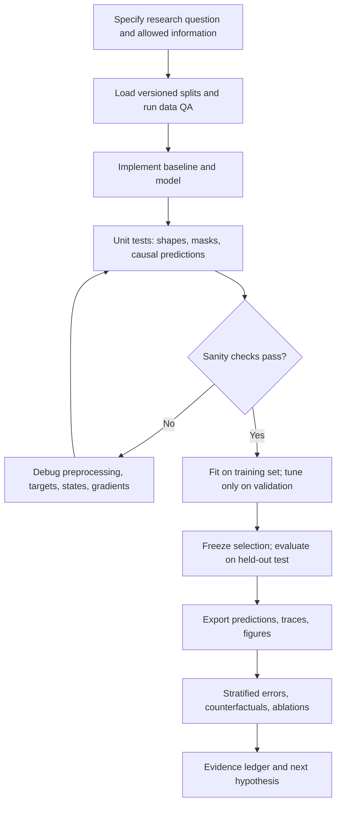

# KT State Lab

**Investigating what Knowledge Tracing models learn, how they adapt to students, and when their representations generalize to unfamiliar educational content.**

> **Project stage:** Research design and baseline development. Models, notebooks, and experiments described below are planned unless a corresponding reproducible run is committed. This README is a research protocol, not a claim of completed findings.

## 1. Motivation and scope

Knowledge Tracing (KT) predicts whether a student will answer an upcoming question correctly given their prior interactions:

$$
\hat p_{u,t}=P(y_{u,t}=1\mid H_{u,\lt t},q_{u,t},x_{u,t}^{\mathrm{allowed}}).
$$

Here $H_{u,<t}$ contains the student's **past** questions and responses, $q_{u,t}$ is the current question, $y_{u,t}\in\{0,1\}$ is its correctness label, and $x^{\mathrm{allowed}}$ contains metadata permitted by the evaluation protocol.

Good prediction does not automatically mean that a model has recovered a student's true mastery. Two models can output the same probability using very different evidence: accumulated concept knowledge, recent response streaks, item difficulty, or semantic similarity.

Our objective is therefore to understand **what models represent, how their internal states change, why they make errors, and which mechanisms support cold-start generalization**.



### In scope

- BKT/IRT-type probabilistic baselines; neural recurrent, memory-based, attention-based, and meta-learning approaches; eventually semantic/inductive KT.
- **Knowledge state:** potentially longer-lived proficiency about concepts, versus **learning/performance state:** potentially shorter-lived influences on responses. These are hypotheses, not necessarily separately identifiable variables in real student data.
- Synthetic students with known hidden states, and real-data evaluations with strictly defined information access.
- Student, question, concept, and domain cold-start settings, **reported separately**.
- Notebook-based explanation, interpretability probes, controlled ablation, calibration, and failure analysis.

### Not initial claims or goals

- We are not claiming that a latent vector dimension is a cognitive concept or that attention weights are explanations.
- We are not implementing a proposed DKVMN evidence gate before understanding the original baselines.
- We are not assuming MAML solves unseen-question or unseen-concept generalization merely because it adapts to new students.

## 2. Cold-start taxonomy

| Protocol                      | Held out during supervised KT training                | Allowed at inference                                                | Research priority   |
| ----------------------------- | ----------------------------------------------------- | ------------------------------------------------------------------- | ------------------- |
| **CS-S: New student**         | Student identity and response history                 | A short chronological support prefix of observed responses          | **Active: MAML-KT** |
| **CS-Q: New question**        | Global question ID and its supervised response labels | Item text, known KC mapping, or other explicitly permitted metadata | Planned priority    |
| **CS-K: New concept**         | Global KC and associated supervised responses         | KC description/relations if authorized by the protocol              | Planned priority    |
| **CS-QK: New item + concept** | Both question and KC                                  | External semantic evidence if explicitly allowed                    | Later               |
| **CS-D: New domain**          | New course/institution/question bank                  | Specified target-side information                                   | Exploratory         |

A question encountered for the first time **by one student** may still be well known to the model. This is _student-level novelty_, not global CS-Q. Likewise, a first-seen student KC is not necessarily a globally held-out KC. All plots and tables must state the distinction.

Our immediate three assigned workstreams address **data validity**, **probabilistic state/response modeling**, and **few-shot new-student adaptation**. The broader goal is to expand to CS-Q and CS-K only when suitable datasets and metadata are verified.

## 3. Research questions

| ID                              | Question                                                                                             | Required evidence                                                            |
| ------------------------------- | ---------------------------------------------------------------------------------------------------- | ---------------------------------------------------------------------------- |
| **RQ1: Prediction**             | How reliably do models predict the next response?                                                    | ROC-AUC, log loss, Brier, calibration, accuracy, uncertainty                 |
| **RQ2: Representation**         | What information about student ability and concepts is encoded in a model state?                     | Native-state traces, held-out probes, synthetic truth, cross-seed alignment  |
| **RQ3: Dynamics**               | How do correct/incorrect responses, item order, and practice change predictions and representations? | Matched counterfactual histories, transition curves, sensitivity experiments |
| **RQ4: New-student adaptation** | What benefit does few-shot adaptation provide over merely reading a short history?                   | CS-S loss/AUC versus support size and position; MAML versus matched controls |
| **RQ5: Content generalization** | Can models represent globally unseen questions and KCs without using their supervised labels?        | CS-Q/CS-K splits, semantic controls, novelty-stratified error                |
| **RQ6: Failure mechanisms**     | Which students, items, or histories cause confident errors, and why?                                 | Sliced evaluation, calibration, case studies, ablations, negative controls   |

**Evidence hierarchy:** distinguish mathematical results, implementation invariants, empirical observations, and educational interpretations. A visually separated cluster or high AUC proves neither student mastery recovery nor causal concept transfer.

## 4. Active team workstreams

All teammates use **one versioned set of data splits and evaluation targets**. A dataset/protocol owner maintains it; that does not mean other researchers cannot do their own EDA or model-specific feature preparation. Models may use different features only if their information budgets are documented.

### Workstream 1 — Data collection, processing, and EDA

**Goal:** Make scientifically valid experiments possible, especially new-student evaluation and later unseen-question/concept evaluation.

**Theory:** generalization under entity-level distribution shift; observational bias; train/test contamination; sequential prediction causality.

**Collection and audit**

1. Survey official datasets and documentation. Prioritize ASSISTments 2009/2015/2017 for the selected MAML-KT reproduction; evaluate XES3G5M and other question-rich datasets for future CS-Q/CS-K _after confirming text and KC metadata availability and licensing_.
2. Record source URLs, publication references, permitted use, dataset version/checksums, data dictionaries, time coverage, student/question/KC counts, question text, timestamps, repeated attempts, and multi-KC mappings.
3. Do not collect identifiable minors' records or acquire restricted data without permission. Keep raw data immutable, and avoid committing raw/identifying student data or large binaries to Git.

**Processing contract**

A canonical interaction table should specify `student_id`, `interaction_id`, `step`, `question_id`, `kc_ids`, `correct`, optional `timestamp`, optional `question_text`, and source-specific metadata. Explicitly document how null IDs, invalid labels, duplicates, multi-KC items, repeat attempts, and out-of-order timestamps are treated. Preserve row provenance.

Publish deterministic integer mappings and **student-disjoint** train/validation/test manifests. For each new student, construct a strictly chronological support prefix and later query targets. Create global question/KC holdouts only for the corresponding separate protocols. Fit label-dependent statistics (such as item difficulty or response-derived graphs) on training data alone.

**EDA notebook and figures**

| Diagnostic                                      | Research question / failure it detects                            |
| ----------------------------------------------- | ----------------------------------------------------------------- |
| Missingness and duplication report              | Are invalid rows silently removed?                                |
| Sequence length histogram + CDF                 | How many usable students have 1, 3, 5, 10, or 15 interactions?    |
| Correctness by within-student position          | Does early-stage class prevalence change?                         |
| Question/KC frequency long-tail                 | Are performance gains concentrated on popular items?              |
| Student–KC/question coverage plot               | How sparse is the curriculum?                                     |
| KC transition matrix and first-seen-KC timeline | Does new-student difficulty actually come from unfamiliar skills? |
| Time gap distribution when timestamps are valid | Is chronological ordering reliable?                               |
| Split overlap + input availability matrix       | Are our cold-start definitions valid and comparable?              |

**Deliverables:** dataset cards, preprocessing and split code, validation tests, EDA notebook, manifest hashes, feature-permission table. **Acceptance:** teammates can reproduce identical splits, inspect counts and metadata limitations, and verify no forbidden student overlap or future-label use.

### Workstream 2 — BKT and IRT-like response models

**Goal:** Establish interpretable baselines to distinguish actual inferential benefits from the strength of simple response statistics.

**Theory A: BKT.** A latent mastered/not-mastered variable $z_{u,c,t}$ evolves according to a transition model; observed responses depend on mastery, guesses, and slips. The model maintains a posterior belief $P(z_{u,c,t}=1\mid H_{u,<t})$. This posterior is not directly observed cognition.

**Theory B: IRT.** A representative 2PL response model is

$$
P(y_{u,q}=1\mid\theta_u,a_q,b_q)=\sigma\!\left(a_q(\theta_u-b_q)\right),\quad a_q>0,
$$

where $\theta_u$ represents ability, $b_q$ difficulty, and $a_q$ discrimination. A 1PL variant constrains discrimination. **Static IRT is not automatically a temporal KT process**; new-student ability estimation must use a prior and _permitted support responses_, never test-query labels.

**Tasks**

1. Verify the chosen BKT and IRT variants mathematically, including parameter fitting and identifiability caveats.
2. Implement a global mean and smoothed per-KC rate baseline before complex models.
3. Implement BKT filtering and one justified IRT formulation; document fitting method (EM, likelihood optimization, Bayesian posterior, etc.).
4. Evaluate on known-state synthetic students and shared real-data CS-S splits, with matching support/query definitions.
5. Inspect the assumptions behind guessing, slipping, difficulty, and stable versus changing ability.

**Figures:** BKT state-transition diagram, IRT item characteristic curves, per-student ability/posterior trajectories, synthetic true-versus-inferred state plots, response counterfactuals, performance/calibration versus support $K$, and parameter-sensitivity heatmaps.

**Acceptance:** verified probabilistic updates, sensible parameter estimates or diagnosed non-identifiability, no target-student fitting outside support, reproducible results, and matched benchmark predictions.

### Workstream 3 — MAML-KT for new students

**Goal:** Reproduce and critically investigate whether gradient-based meta-learning improves cold-start adaptation to unseen students.

**Reference:** Bhattacharjee & Wayllace, [MAML-KT: Addressing Cold Start Problem in KT for New Students via Few-Shot Model-Agnostic Meta Learning](https://arxiv.org/abs/2603.00137) (2026). The paper studies few-shot new-student adaptation and reports evaluation on ASSISTments datasets. Independently inspect its exact backbone, support/query boundaries, and benchmark before claiming reproduction.

**Theory:** each student is a task. Given meta-initialization $\theta$, adapt using the student's _earlier_ labeled support examples $S_u$:

$$
\theta'_u=\theta-\alpha\nabla_\theta\mathcal L_{S_u}(\theta).
$$

Optimize the shared initialization for performance on later examples $Q_u$:

$$
\min_\theta\,\mathbb E_{u\sim\mathrm{train}}\left[\mathcal L_{Q_u}(\theta'_u)\right].
$$

**Critical distinction:** observing responses and updating a GRU's _hidden state_ is not the same as doing support-set gradient adaptation of its _parameters_. Our ablations must separate these mechanisms.

**Tasks**

1. Reconstruct the exact model backbone and paper-defined tasks, windows, loss, meta-train/meta-validation partitions, and adaptation procedure.
2. Implement a matched ordinary ERM-trained GRU KT baseline: same architecture and history, without meta-training.
3. Compare ERM (history only), ERM + support fine-tuning, MAML initialization without adaptation, and MAML with 1/2 inner-loop updates when valid.
4. Analyze support sizes $K\in\{0,1,3,5,10\}$ where feasible, preserving the paper's own reported early-position windows separately.
5. Break down results by first-seen skill **for the student**, support/query KC overlap, difficulty, student history length, and cohort.
6. Measure adaptation time/cost, run repeated seeds, and report confidence intervals grouped by student.

**Figures:** support/query timeline, MAML inner/outer gradient diagram, early-position log loss/AUC curves, performance versus support $K$, per-student before/after adaptation scatter, first-seen-KC error heatmap, support-query KC overlap versus gain, training dynamics, and representative failure stories.

**Acceptance:** student-disjoint tasks, strictly chronological support/query split, no query-label adaptation, matched backbone and optimization budgets, reproducible metrics, and clear separation of paper reproduction from our extensions.

### Research lead — integration

Own the research hypotheses, split approval, interface and figure conventions, shared experiment registry, cross-workstream review, and claims log. No workstream should privately change the held-out population or target definition and then compare metrics as though the benchmarks were identical.

## 5. Training and evaluation protocol for **any** model



**Before fitting:** validate sequence order and response encoding, proper padding masks, no current-answer leakage, valid question/KC indices, one hand-computable small case, and correct student/task isolation. For neural networks, an intentionally tiny training subset should be overfittable; failure is a useful debugging signal.

**During fitting:** track objective, validation log loss and Brier score, AUC when defined, class balance, learning-rate history, model gradients/parameter norms, and architecture-specific states. Save configuration, random seed, software versions, code revision, dataset/split identifier, and selected checkpoint.

**After fitting:** evaluate exact same held-out targets for all compatible models, using the declared information budget and online-state-update policy. Export an aligned prediction table:

```text
run_id,model,split_id,seed,student_id,step,question_id,kc_ids,
y_true,p_pred,support_size,cold_start_type,
is_first_student_kc,is_globally_unseen_kc,item_frequency_train
```

**Metrics:** log loss and Brier score as primary probability scores; AUC for discrimination (when both classes are present), accuracy for thresholded predictions; reliability diagrams and calibration errors; response-weighted and student-weighted summaries; repeated seeds and **student-clustered** uncertainty estimates. For synthetic state recovery, quantify agreement with true latent states using an explicitly justified probe or alignment rather than comparing arbitrary hidden coordinates.

## 6. Error analysis: diagnose failures, not just summarize metrics

| Error slice                  | Hypothesis to test                             | Suggested figure                                 |
| ---------------------------- | ---------------------------------------------- | ------------------------------------------------ |
| Steps 1–15                   | Early-history representations are weak         | Error/calibration versus interaction index       |
| Support $K$                  | Meta-adaptation needs more evidence            | Log loss versus support length                   |
| First-seen skill for student | Novel student skills cause cold-start failures | Skill-introduction timeline + loss               |
| Globally unseen question/KC  | Model requires trained ID features             | Separate CS-Q/CS-K breakdown                     |
| Difficult / rare items       | Data sparsity and prevalence drive error       | Error by training-only difficulty/frequency bins |
| Confident errors             | Poor calibration or label noise                | Reliability diagram and case examples            |
| Short vs long histories      | Old evidence is lost or wrongly overweighted   | Early-response perturbation sensitivity          |
| Support/query skill mismatch | Adaptation is too skill-specific               | KC-overlap versus adaptation benefit             |
| Synthetic guesses/slips      | Model mistakes response noise for mastery      | Ground-truth-versus-estimated trajectory         |
| Student cohorts              | Average scores hide persistent failures        | Student-level error distributions                |

**Investigation loop:** (1) identify a failure slice, (2) verify labels/samples and counts, (3) compare on the exact same examples with a simple baseline, (4) formulate competing explanations, (5) intervene by changing one permitted variable or running a control, (6) repeat across seeds/cohorts, (7) label conclusions as proven, empirically supported, or unresolved.

Never equate attention weights or separated t-SNE clusters with educational causality. Report whether a plotted quantity is **observed data, simulator truth, or model-derived**.

## 7. LSKT-inspired notebooks and visual explanations

We take inspiration from Wang et al., [_Learning States Enhanced Knowledge Tracing: Simulating the Diversity in Real-World Learning Process_](https://arxiv.org/abs/2412.19550) (2024 preprint), particularly its narrative progression from a learner story to architecture diagrams, ablations, embeddings, and time-evolving representations.

| LSKT source                              | What we learn                          | Our research artifact                                                     |
| ---------------------------------------- | -------------------------------------- | ------------------------------------------------------------------------- |
| **Figure 1:** six-interaction motivation | Start from a tangible student example  | Six-to-thirty-step student story + competing explanations                 |
| **Figure 2:** architecture pipeline      | Make information flow understandable   | Causal input/read/predict/update diagram for each model                   |
| **Figure 3:** component ablations        | Ask what each component actually adds  | Matched removal/control comparison with uncertainty                       |
| **Figure 4:** cluster-count sweep        | Inspect hyperparameter sensitivity     | Support-size, state-dimension, prior/regularization curves                |
| **Figures 5–6:** t-SNE representations   | Compare latent spaces visually         | Fixed-sample PCA/t-SNE plus independent probe metrics                     |
| **Figure 7:** 30-step mastery timeline   | Expose state evolution per interaction | Aligned response, synthetic truth, probe predictions, native state, error |

LSKT's attractive representation plots are **exploratory**, not definitive evidence that a latent coordinate is genuine mastery. Our improvement is to pair visualizations with **ground truth on synthetic data, matched behavioral probes, negative controls, and documented uncertainty**.

**Required notebook template:** scientific question → mathematical hypothesis + diagram → reproducible code + checks → figures and metrics → interpretation and limitations → next falsifiable experiment.

**Recommended figure inventory:**

- `RQ1_F01_data_quality.png` — missingness, lengths, prevalence, sparsity.
- `RQ4_F02_coldstart_splits.svg` — entities held out and permitted inputs.
- `RQ2_F03_student_story.png` — observed interactions vs true simulated knowledge.
- `RQ1_F04_training_curves.png` — train/validation dynamics.
- `RQ2_F05_bkt_irt_state.png` — posterior/ability and item response curves.
- `RQ4_F06_maml_adaptation.png` — before/after, by $K$ and early question position.
- `RQ3_F07_state_trajectories.png` — true state vs fixed-probe predictions.
- `RQ6_F08_error_slices.png` — skill novelty, difficulty, calibration.
- `RQ5_F09_unseen_content.png` — later CS-Q and CS-K separately.
- `RQ6_F10_ablation.png` — matched ablations and uncertainty.

Export figure PNG plus SVG where useful and the underlying numeric CSV/NPZ/Parquet trace. Figure captions must specify target population, sample size, data type, and conclusions/limitations. Do not commit heavy checkpoints or raw datasets.

## 8. Proposed repository layout

_Target structure; files below are not claimed to exist yet._

```text
kt-state-lab/
├── README.md
├── pyproject.toml
├── configs/
├── data/
│   └── README.md                 # dataset access and licensing, not raw student logs
├── docs/
│   ├── dataset_cards/
│   ├── protocols/
│   └── literature/
├── src/ktlab/
│   ├── data/
│   ├── simulation/
│   ├── models/
│   │   ├── bkt.py
│   │   ├── irt.py
│   │   ├── dkt.py
│   │   ├── dkvmn.py
│   │   ├── akt.py
│   │   └── maml_kt.py
│   ├── training/
│   ├── evaluation/
│   └── visualization/
├── notebooks/
│   ├── 00_research_overview.ipynb
│   ├── 01_data_eda.ipynb
│   ├── 02_synthetic_student_stories.ipynb
│   ├── 03_bkt_irt_investigation.ipynb
│   ├── 04_maml_new_student.ipynb
│   ├── 05_neural_kt_representations.ipynb
│   ├── 06_coldstart_error_analysis.ipynb
│   └── 07_model_comparisons.ipynb
├── splits/                       # deterministic versioned manifests
├── experiments/                  # configuration and reproducibility notes
├── outputs/                      # generated artifacts; normally gitignored
├── reports/
│   ├── figures/                  # selected lightweight, reproducible figures
│   └── findings.md
└── tests/
    ├── test_data_contract.py
    ├── test_split_integrity.py
    ├── test_causality.py
    └── test_model_updates.py
```

Suggested experiment output:

```text
outputs/<experiment_id>/
  config.yaml
  metrics.json
  predictions.parquet
  traces.npz
  checkpoint.pt
  figures/
```

Keep shared code in reusable modules and notebooks focused on scientific explanation and exploration. Avoid duplicating large model implementations across notebooks.

## 9. Milestones and contribution rules

1. **M0 — Protocol and EDA:** dataset inventory, first canonical schema, CS-S split manifests, data QA, student-story visualization.
2. **M1 — Interpretable baselines:** global/KC estimators, BKT, IRT-like model, synthetic validation and early-position diagnostics.
3. **M2 — MAML-KT reproduction:** independently checked paper protocol, matched GRU baselines, support-length curves, skill-novelty failure analysis.
4. **M3 — Comparative representation study:** DKT/DKVMN/selected attention models using the same evaluation target definitions.
5. **M4 — Inductive content KT:** audit text/KC metadata and test selected semantic models for global CS-Q and CS-K.
6. **M5 — Theory-driven improvement:** propose an architectural modification only after a specific limitation is demonstrated.

A PR is reviewable when it contains: a concrete scientific question, documented assumptions, executable implementation or reproducible analysis, verification checks, meaningful plots, and honest interpretation. Keep branches and PRs scoped to one workstream or experiment; do not privately redefine the official benchmark.

**First integration meeting:** approve one initial ASSISTments dataset, its exact CS-S split, support/query policy, a global and BKT/IRT baseline, and MAML-KT's matching GRU comparison.

## 10. Starting references

- Corbett & Anderson, _Knowledge Tracing: Modeling the Acquisition of Procedural Knowledge_ (1994).
- Piech et al., [_Deep Knowledge Tracing_](https://arxiv.org/abs/1506.05908) (2015).
- Zhang et al., [_Dynamic Key-Value Memory Networks for Knowledge Tracing_](https://arxiv.org/abs/1611.08108) (2017).
- Ghosh et al., [_Context-Aware Attentive Knowledge Tracing_](https://arxiv.org/abs/2007.12324) (2020).
- Wang et al., [_Learning States Enhanced Knowledge Tracing_](https://arxiv.org/abs/2412.19550) (2024 preprint): research demonstration and visualization inspiration.
- Bhattacharjee & Wayllace, [_MAML-KT: Addressing Cold Start Problem in KT for New Students via Few-Shot Model-Agnostic Meta Learning_](https://arxiv.org/abs/2603.00137) (2026): assigned new-student method.

---

> **Research principle:** We do not only ask _whether_ a model predicts accurately. We ask **what evidence it used, what state it inferred, how it adapted, when it failed, and what the experiment genuinely establishes.**
